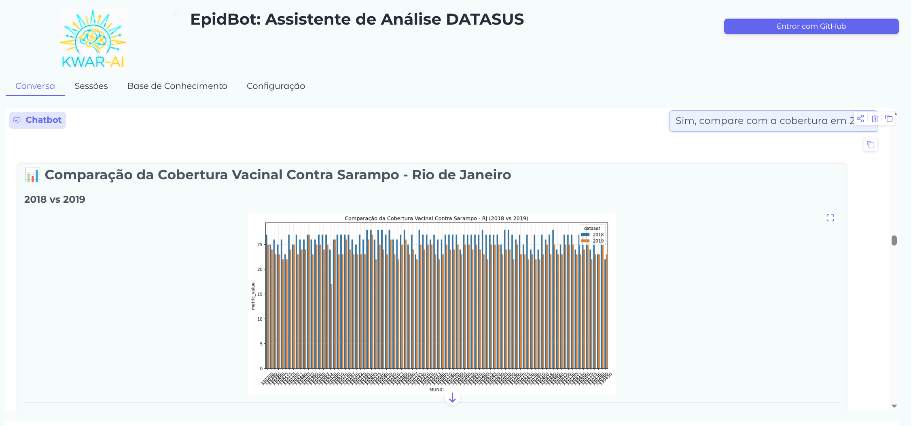

# Inicio Rápido

Comience con EpidBot en 5 minutos.

## Requisitos Previos

Antes de iniciar, asegúrese de:
- Haber instalado las dependencias: `uv sync`
- Haber creado al menos una cuenta de usuario (vea [Autenticación](authentication.md))

## Iniciando EpidBot

### 1. Crear Primer Usuario (Obligatorio)

Si aún no ha creado un usuario:

```bash
uv run python auth_cli.py create-admin
```

Siga las instrucciones para crear un nombre de usuario y contraseña.

### 2. Iniciar la Aplicación

```bash
cd epidbot
cd frontend && pnpm dev
```

### 3. Iniciar Sesión

Abra su navegador en `http://localhost:3000`.

Verá una pantalla de inicio de sesión. Ingrese su nombre de usuario y contraseña para acceder a EpidBot.

## Uso Básico




### 1. Descargar Datos

Pida a EpidBot que descargue datos de salud:

```
Baixe os dados de Dengue para 2023
```

O en inglés:

```
Download Dengue data for 2023
```

### 2. Explorar Datos Disponibles

```
Liste todos os dados disponíveis
```

```
What data is available in the catalog?
```

### 3. Consultar Datos

```
Quantos casos de dengue foram reportados em 2023?
```

```
Show me the temporal trend of dengue cases in 2023
```

### 4. Generar Visualizaciones

```
Gere um gráfico da distribuição de casos de dengue por estado
```

```
Create a map showing dengue cases by Municipality
```

### 5. Exportar Resultados

```
Exporte os resultados para CSV
```

## Ejemplos de Consultas

### Descubrimiento de Datos

| Consulta | Descripción |
|----------|-------------|
| "What databases are available?" | Listar bases de datos PySUS |
| "List downloaded datasets" | Mostrar datos en caché |
| "Describe the dengue dataset schema" | Mostrar columnas y tipos |

### Análisis

| Consulta | Descripción |
|----------|-------------|
| "Calculate mean age of patients" | Análisis estadístico |
| "Compare dengue cases 2022 vs 2023" | Comparación temporal |
| "Top 10 municipalities by cases" | Consultas de ranking |

### Visualización

| Consulta | Descripción |
|----------|-------------|
| "Plot time series of cases" | Gráfico de líneas |
| "Bar chart of cases by state" | Gráfico de barras |
| "Map of cases by municipality" | Mapa coroplético |

## Base de Conocimiento

### Buscar Documentación

```
Search the knowledge base for SINAN metadata
```

### Añadir Fuentes

```
Add this documentation to the knowledge base: https://portalsinan.saude.gov.br/
```

## Consejos

1. **Sea específico**: Incluya años, enfermedades y ubicaciones
2. **Solicite visualizaciones**: Pida gráficos al explorar datos
3. **Revise el pensamiento**: Expanda "Agent Thinking" para ver llamadas a herramientas
4. **Use sesiones**: Cree sesiones separadas para diferentes análisis

## Siguientes Pasos

- [Interfaz de Chat](../user-guide/chat.md)
- [Análisis de Datos](../user-guide/analysis.md)
- [Base de Conocimiento](../user-guide/knowledge-base.md)
