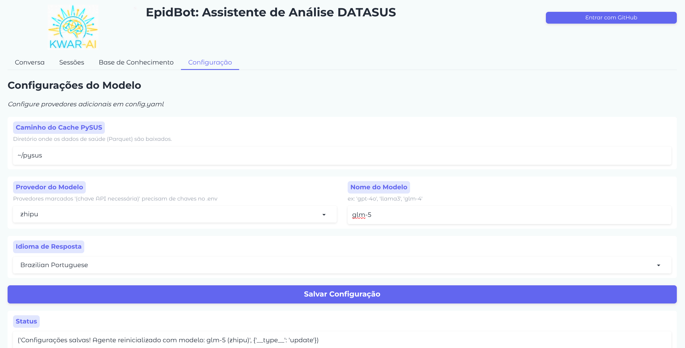

# Configuração

EpidBot é configurado via `config.yaml` e variáveis de ambiente.

## Arquivo de Configuração

O arquivo `config.yaml` é criado automaticamente na primeira execução com valores padrão:

```yaml
# Caminho de armazenamento de dados PySUS
data_dir: "~/public"

# Idioma de resposta
language: "Brazilian Portuguese"

# Idioma da interface
ui_language: "pt-BR"

# Provedor LLM ativo
active_provider: "openai"
active_model: "gpt-4o"

# Configurações de provedores
providers:
  openai:
    type: openai
    api_key_env: OPENAI_API_KEY
    default_model: gpt-4o
  
  ollama:
    type: openai_compatible
    base_url: http://localhost:11434/v1
    default_model: llama3

# Configurações da base de conhecimento
knowledge_base:
  enabled: true
  libby_url: "http://localhost:8000"
  default_collection: "datasus"

# Prompt do sistema (personaliza o comportamento do agente)
system_prompt: |
  You are an analytical assistant for Brazilian health data (DATASUS/SINAN).
  You can download data using PySUS and query it using DuckDB.
  ...

```

## Variáveis de Ambiente

| Variável | Descrição | Padrão |
|----------|-----------|--------|
| `OPENAI_API_KEY` | Chave de API OpenAI | Obrigatório para OpenAI |
| `LIBBY_URL` | URL do servidor Libby | `http://localhost:8000` |
| `OLLAMA_HOST` | URL do servidor Ollama | `http://localhost:11434` |
| `DATA_DIR` | Diretório de dados | Diretório atual |
| `PLOT_DIR` | Diretório de saída de plots | `./plots` |

## Configuração de Provedores

### OpenAI

```yaml
providers:
  openai:
    type: openai
    api_key_env: OPENAI_API_KEY
    default_model: gpt-4o
```

Defina sua chave de API:

```bash
export OPENAI_API_KEY=sk-your-key-here
```

### Ollama (Local)

```yaml
providers:
  ollama:
    type: openai_compatible
    base_url: http://localhost:11434/v1
    default_model: llama3
```

### OpenAI-Compatible Personalizado

Para outros provedores (ex: GLM, DeepSeek):

```yaml
providers:
  glm:
    type: openai_compatible
    base_url: https://open.bigmodel.cn/api/paas/v4
    api_key_env: GLM_API_KEY
    default_model: glm-4
```

## Configurações de Idioma

Idiomas suportados:

- `Brazilian Portuguese` (padrão)
- `Portuguese`
- `English`
- `Spanish`
- Ou qualquer valor personalizado

## Configuração da Base de Conhecimento

```yaml
knowledge_base:
  enabled: true
  libby_url: "http://localhost:8000"
  default_collection: "datasus"
```

Coleções:

- `datasus` - Documentação oficial do DATASUS
- `epidemiology` - Metodologia epidemiológica
- `methodology` - Metodologia de pesquisa

## Configuração do Prompt do Sistema

O campo `system_prompt` define o comportamento e instruções do agente. Você pode personalizá-lo para:

- Mudar a personalidade ou tom do agente
- Adicionar instruções específicas de domínio
- Modificar diretrizes de uso de ferramentas
- Ajustar preferências de visualização

### Variáveis de Template

O prompt do sistema suporta estas variáveis de template:

| Variável | Descrição |
|----------|-----------|
| `{data_dir}` | Caminho para o diretório de dados PySUS |
| `{language}` | Configuração de idioma de resposta |
| `{kb_instructions}` | Instruções da base de conhecimento (quando habilitado) |

**Nota:** Para incluir chaves literais no seu prompt (ex: exemplos JSON), use chaves duplas: `{{` e `}}`.

### Exemplo de Personalização

```yaml
system_prompt: |
  You are a specialized epidemiologist assistant.
  
  Focus on:
  - Disease surveillance patterns
  - Outbreak detection
  - Public health recommendations
  
  Data is stored in: {data_dir}
  
  Respond in: {language}
  
  {kb_instructions}
```

## Alternando Provedores

Via interface:



1. Vá para a aba **Configuração**
2. Selecione o provedor no menu dropdown
3. Digite o nome do modelo
4. Clique em **Salvar Configuração**

Via arquivo de configuração:

```yaml
active_provider: "ollama"
active_model: "llama3"
```

## Caminhos de Dados

Estrutura padrão:

```
~/pysus/
├── SINAN/
│   ├── DENG/
│   ├── CHIK/
│   └── ZIKA/
├── SIM/
└── SIH/
```

Caminho personalizado:

```yaml
data_dir: "/data/health-data"
```
