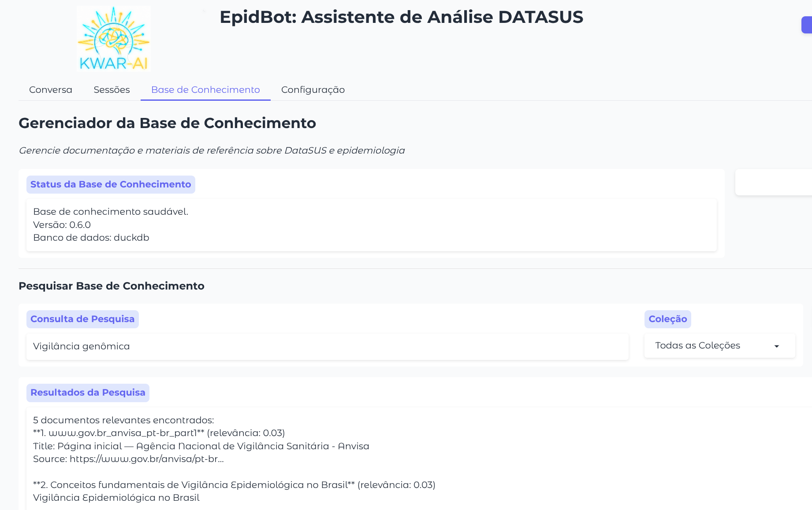

# Base de Conhecimento

A Base de Conhecimento permite armazenar e recuperar documentação sobre DataSUS, epidemiologia e tópicos relacionados.

## Visão Geral

A base de conhecimento usa [Libby](https://github.com/Deeplearn-Ped/libby) para:

- Embedding de documentos (armazenamento vetorial)
- Busca semântica
- Geração aumentada por recuperação (RAG)

## Aba Base de Conhecimento



### Verificar Status

Clique em **Verificar Status** para confirmar se o servidor Libby está rodando.

### Buscar

1. Digite uma consulta de busca
2. Selecione uma coleção (ou "Todas as Coleções")
3. Clique em **Buscar**

Os resultados mostram trechos relevantes de documentos com pontuações de relevância.

### Adicionar Fontes

#### Páginas Web

1. Digite a URL
2. Selecione uma coleção
3. Clique em **Adicionar Página Web**

O sistema irá:

1. Buscar a página web
2. Extrair o conteúdo de texto
3. Dividir em chunks se necessário
4. Realizar embedding e armazenar

#### Conteúdo de Texto

1. Cole o conteúdo de texto
2. Forneça um nome de documento
3. Selecione uma coleção
4. Clique em **Adicionar Texto**

#### Carregar Documentos

1. Selecione um arquivo PDF
2. Escolha uma coleção
3. Clique em **Carregar & Realizar Embedding**

### Gerenciar Fontes

- **Listar Fontes**: Ver todos os documentos com embedding
- **Listar Coleções**: Ver coleções com contagens de documentos

## Coleções

| Coleção | Propósito |
|---------|-----------|
| `datasus` | Documentação oficial do DATASUS |
| `epidemiology` | Métodos e conceitos epidemiológicos |
| `methodology` | Metodologia de pesquisa |

## Integração com o Agente

O agente pode:

- **Buscar**: Consultar a base de conhecimento para informações relevantes
- **Adicionar fontes**: Adicionar automaticamente recursos web valiosos
- **Listar fontes**: Ver que documentação está disponível

### Exemplos de Consultas

```
Search the knowledge base for SINAN field definitions
```

```
Add this page to the knowledge base: https://portalsinan.saude.gov.br/
```

```
What sources are available in the knowledge base?
```

## Detecção de Duplicatas

O sistema verifica automaticamente duplicatas:

- URLs são verificadas por domínio + caminho
- Documentos de texto são verificados por nome
- Documentos divididos em chunks (ex: `doc_part1`) são reconhecidos

## Divisão em Chunks

Documentos grandes são divididos automaticamente:

- Tamanho máximo de chunk: 1024 caracteres
- Sobreposição: 100 caracteres
- Limites de parágrafos são preservados

## Referência da API

### LibbyClient

```python
from epidbot.knowledgebase import LibbyClient

client = LibbyClient()

# Adicionar texto
client.add_text(
    text="Content to embed",
    doc_name="my_document",
    collection_name="datasus"
)

# Adicionar página web
client.add_webpage(
    url="https://example.com",
    collection_name="datasus"
)

# Buscar
results = client.search(
    query="SINAN notification fields",
    collection_name="datasus",
    num_docs=5
)

# Listar documentos
docs = client.list_documents(collection_name="datasus")

# Verificar existência
exists = client.document_exists("my_document", "datasus")
```

## Melhores Práticas

1. **Use coleções apropriadas**: Organize documentos por tópico
2. **Adicione fontes ricas em metadados**: Documentação oficial funciona melhor
3. **Verifique antes de adicionar**: Evite conteúdo duplicado
4. **Verifique embeddings**: Use busca para confirmar que o conteúdo está acessível
5. **Manutenção regular**: Periodicamente revise e limpe as fontes
